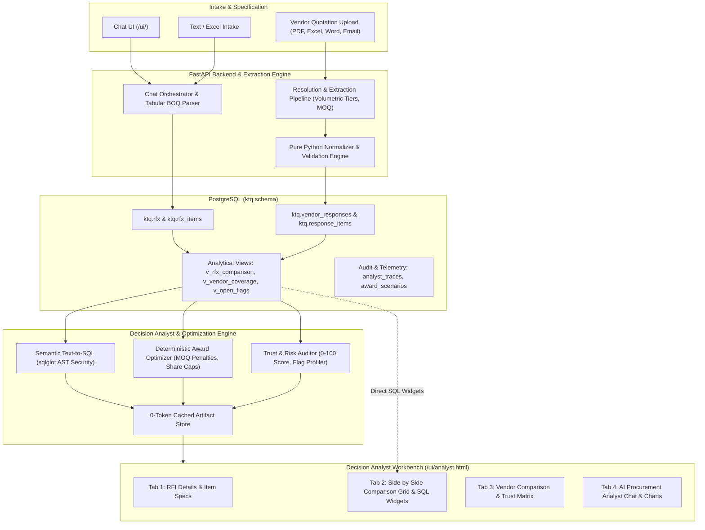

# AI Procurement Analyst & Packaging RFx Platform

An enterprise-grade AI procurement platform powered by **FastAPI**, **PydanticAI**, and **PostgreSQL**, designed to automate packaging RFx intake, multi-modal quotation ingestion & OCR extraction, and mathematically grounded decision-support analytics.

---

## 1. System Overview & Core Capabilities

The platform unifies the full procurement lifecycle into a seamless digital workflow:

1. **Conversational & Tabular RFI Intake**:
   - Conversational requirement intake via chat (`POST /api/chat`) and structured text/Excel endpoints.
   - Enterprise Tabular BOQ ingestion: Parses multi-column TSV, pipe-delimited, and copy-pasted tables (30+ items per turn) with preserved SKU codes, quantities, UOMs, INR baseline prices, and 2D/3D dimensions.
   - Natural language line-item operations (batch range deletions, comma-separated lists, relative removals, attribute updates) with contiguous `1..N` re-indexing.
   - Automatic separation of commercial terms (payment, delivery, validity, freight) and boilerplate from product line items.
2. **Multi-Modal Vendor Quotation Ingestion & OCR**:
   - Accepts quotations in **any** format: Excel (`.xlsx`, `.xls`, `.csv`), PDF (rasterized + text), Word (`.docx`), Email (`.eml`), images, or JSON payloads.
   - Immediate byte-for-byte document persistence with SHA-256 idempotency scoped to target RFxs (`rfx_id`).
   - 6-signal scored resolution engine matching quotes to RFxs and vendors with automatic entity creation.
   - Multi-tiered volumetric discount extraction: Captures rate break brackets, volume tiers, and Minimum Order Quantities (MOQ).
   - Deterministic normalization: Currency conversion to INR, UOM standardization, pricing trap detection (per 100/1000), and visual 10%-padded PNG bounding box crops.
3. **Decision Analyst & Semantic Text-to-SQL Intelligence**:
   - Natural language decision-support assistant backed by the Wren MDL semantic layer.
   - Normalized few-shot intent retrieval with complex multi-table joins cross-referencing questionnaire answers, terms, flags, and item prices.
   - Dual-mode narrative synthesis: LLM-driven executive summaries analyzing multi-vendor split trade-offs, with a deterministic domain fallback for offline operation.
   - Zero hallucinated math: All calculations, rankings, and allocations derive strictly from deterministic Python tools and PostgreSQL views.
   - Ground-truth traceability post-check verifying stated figures against executed database rows.
   - 0-token artifact caching for instant retrieval of previously queried tables and charts.
4. **Deterministic Sourcing Optimization & Scenario Simulation**:
   - Sourcing solvers: Pure L1 cheapest per line, single-vendor award, and multi-vendor split allocations (e.g. 60% vendor share cap).
   - Minimum Order Quantity (MOQ) penalty constraints: Configurable modes (`shortfall_penalty`, `quantity_bump`, `exclude_below_moq`).
   - Technical & quality knockout questionnaire enforcement.
   - Decision-support simulation boundary: Scenarios inform buyer strategy without executing binding awards.
5. **Unified Modern Client Dashboards**:
   - **Procurement Chat Workbench** (`/ui/`): Interactive RFI creation, progress loaders, and conversational requirement gathering.
   - **Decision Analyst Workbench** (`/ui/analyst.html`): 4-tab dashboard featuring RFI Details & Line Items, Side-by-Side Comparison Matrix with 5 standard SQL widgets, Vendor Comparison & Trust Audits, and AI Analyst Chat with Chart.js analytics and multi-sheet XLSX export packs.

---

## 2. Architecture Diagram



---

## 3. Quickstart & Installation

### 1. Prerequisites

- Python 3.10+ (tested with Python 3.14)
- PostgreSQL database (local or cloud, e.g. Neon, Supabase, RDS)

### 2. Environment Setup

```bash
# Clone the repository
git clone <repo-url> ktq2
cd ktq2

# Create and activate virtual environment
python3 -m venv .venv
source .venv/bin/activate

# Install dependencies
pip install -r requirements.txt
```

### 3. Configure Secrets

Copy `.env.example` to `.env` and fill in your settings:

```bash
cp .env.example .env
```

```dotenv
# LLM Providers (at least one recommended; deterministic fallback used if unset)
OPENAI_API_KEY=
ANTHROPIC_API_KEY=
GOOGLE_API_KEY=
OLLAMA_BASE_URL=http://localhost:11434

# PostgreSQL Configuration
POSTGRES_MODE=cloud
DB_HOST=your-host
DB_PORT=5432
DB_NAME=your-db
DB_USER=your-username
DB_PASSWORD=your-password
DB_SSL_MODE=require
DB_SCHEMA=ktq
```

### 4. Run the Server

```bash
# Using the production cloud startup script:
./scripts/run_server.sh

# Or directly with uvicorn:
.venv/bin/uvicorn backend.app.main:app --host 0.0.0.0 --port 8000 --reload
```

Then access:

- **Chat UI**: [http://localhost:8000/ui/](http://localhost:8000/ui/)
- **Decision Analyst Workbench**: [http://localhost:8000/ui/analyst.html](http://localhost:8000/ui/analyst.html)
- **Interactive OpenAPI Docs**: [http://localhost:8000/docs](http://localhost:8000/docs)
- **System Health**: [http://localhost:8000/health](http://localhost:8000/health)
- **Database Health**: [http://localhost:8000/health/db](http://localhost:8000/health/db)

---

## 4. Cloud & Production Deployment

### Host-Agnostic Dynamic Endpoints

The platform is fully decoupled from host environments:

- **Origin-Relative Endpoints**: All client calls use relative paths (`/api/chat`, `/api/rfi`, etc.), eliminating hardcoded `localhost:8000` issues when hosted remotely on Oracle Cloud, AWS, GCP, or private servers.
- **Self-Healing LocalStorage**: Frontend automatically detects when running on a remote host and migrates any legacy cached `localhost:8000` URLs in browser `localStorage`.
- **0.0.0.0 Binding**: `scripts/run_server.sh` binds to `0.0.0.0` and configures proxy header forwarding (`--proxy-headers --forwarded-allow-ips "*"`).

### Oracle Cloud Compute (OCI) Deployment

1. Set up an Ubuntu instance in OCI.
2. In the OCI Console, add an **Ingress Rule** to your VCN's Security List for TCP port `8000` (or `80`/`443` if using Nginx/Caddy).
3. Clone the repository, configure `.env`, install requirements, and execute `./scripts/run_server.sh`.
4. Access `http://<public-ip>:8000/ui/`.

### Vercel Serverless Deployment

- Configured via `vercel.json` and ASGI handler `api/index.py`.
- In the Vercel Dashboard, configure environment variables (`DATABASE_URL`, `DB_SCHEMA`, and LLM keys).
- Deploy with `vercel --prod`.

---

## 5. REST API Reference

### Health & Monitoring

| Method | Endpoint | Description |
| --- | --- | --- |
| `GET` | `/health` (or `/api/health`) | Verifies backend readiness and initialized agent catalog. |
| `GET` | `/health/db` (or `/api/db/health`) | Verifies PostgreSQL connectivity and dynamic schema existence. |

### Packaging RFI Lifecycle

| Method | Endpoint | Description |
| --- | --- | --- |
| `POST` | `/api/chat` | Conversational RFI creation, tabular BOQ intake, and natural language line operations. |
| `POST` | `/api/rfi/intake` | Extracts structured requirements from unstructured text. |
| `POST` | `/api/rfi/intake/excel` | Multi-sheet spreadsheet intake (`.xlsx`, `.csv`) with header alias mapping. |
| `POST` | `/api/rfi` | Direct creation of structured RFI records. |
| `GET` | `/api/rfi` | List all RFIs/RFXs with title, status, and metadata for dropdown selectors. |
| `GET` | `/api/rfi/{id}` | Retrieve complete RFI details, commercial terms, and line items. |
| `PATCH` | `/api/rfi/{id}` | Update editable fields (`title`, `terms`, `status`, `validity_days`). |
| `POST` | `/api/rfi/{id}/trigger` | Transitions RFI status to `TRIGGERED` and records timestamp. |

### Vendor Response Submission & Document Inspection

| Method | Endpoint | Description |
| --- | --- | --- |
| `POST` | `/api/vendor-responses` | Submits vendor quotes in any format (202 Accepted, async processing). |
| `GET` | `/api/vendor-responses/{id}` | Detailed pipeline status, per-document progress, and scored resolution reasoning. |
| `GET` | `/api/vendor-responses/{id}/items` | Extracted line items, matching states, validation flags, and crop URLs. |
| `GET` | `/api/vendor-responses/{id}/documents/{doc_id}/raw` | Retrieves original document bytes exactly as uploaded. |
| `GET` | `/api/response-items/{item_id}/crop` | Cropped PNG visual evidence bounding box with 10% padding. |
| `GET` | `/api/rfx/{rfx_id}/responses` | All supplier submissions for an RFx with coverage metrics. |
| `POST` | `/api/vendor-responses/{id}/reprocess` | Re-executes extraction pipeline as a new run. |
| `PATCH` | `/api/response-items/{item_id}` | Buyer manual line-item correction audit trail. |

### Decision Analyst & Sourcing Intelligence

| Method | Endpoint | Description |
| --- | --- | --- |
| `POST` | `/api/analyst/ask` | Natural language decision Q&A with 0-token caching for repeated questions. |
| `GET` | `/api/analyst/sessions/{id}` | Session interaction history and telemetry traces. |
| `POST` | `/api/analyst/feedback` | Records user ratings, comments, and corrected SQL queries for traces. |
| `GET` | `/api/rfx/{id}/comparison` | Side-by-side comparison matrix and 5 standard SQL widgets. |
| `GET` | `/api/rfx/{id}/trust` | Supplier reliability scores (0-100), risk tier, points reasoning, and money-at-risk. |
| `GET` | `/api/rfx/{id}/artifacts` | Fetches stored graphs, Chart.js specs, and generated reports (0 tokens). |
| `POST` | `/api/rfx/{id}/award/scenarios` | Executes award simulation with constraints (MOQ, share caps, knockouts). |
| `GET` | `/api/rfx/{id}/award/scenarios/{sid}` | Fetches stored scenario allocation details. |
| `POST` | `/api/rfx/{id}/award/scenarios/{sid}/finalize` | Saves immutable scenario audit record and flag acceptance. |
| `GET` | `/api/exports/{id}` | Downloads multi-tab Excel workbooks with mandatory *Assumptions & Caveats* sheet. |

---

## 6. Analytical Tuning & Configuration

All system knobs are externalized in configuration files:

1. **Semantic Text-to-SQL Models (`config/wren_semantic_model.yaml` & `config/wren_mdl.json`)**:
   Defines field semantics (`effective_price_inr`, `coverage_pct`, `review_status`) to guide accurate SQL generation.
2. **Few-Shot Examples (`config/wren_examples.yaml`)**:
   24+ question-to-SQL examples covering complex joins (questionnaires, terms, flags, item prices, lead times, knockouts). User-rated feedback can be synced into examples via `python scripts/export_feedback_to_examples.py`.
3. **Analyst Orchestrator Prompt (`config/prompts/analyst_system_v1.txt`)**:
   Governs comparability-first rules, data state transparency (`CONFIDENT` vs `REVIEW`), and nuanced multi-vendor split trade-off summaries (cost delta, concentration risk, operational overhead, MOQ impacts).
4. **Extraction Prompts (`backend/app/vendor/prompts.py`)**:
   Guides multi-tiered volumetric discount table extraction, bracket parsing, and OCR scan column alignment.
5. **Security & Guardrail Knobs (`backend/app/analyst/tools/sql_runner.py`)**:
   `sqlglot` AST parser enforcing table allowlists, statement timeout (`5000ms`), and parameter limits.

---

## 7. Verification & Test Suite

Run the full pytest suite covering all 86 unit and integration tests:

```bash
PYTHONPATH=. .venv/bin/pytest tests/ backend/tests/ -v
```

Run the 33-question Decision Analyst benchmark:

```bash
PYTHONPATH=. .venv/bin/python scripts/eval_analyst.py
```

Test logs are output to [`artifacts/logs/test_fine_tuning_and_consolidation.log`](file:///Users/akshaykumar/code/ktq2/artifacts/logs/test_fine_tuning_and_consolidation.log).
