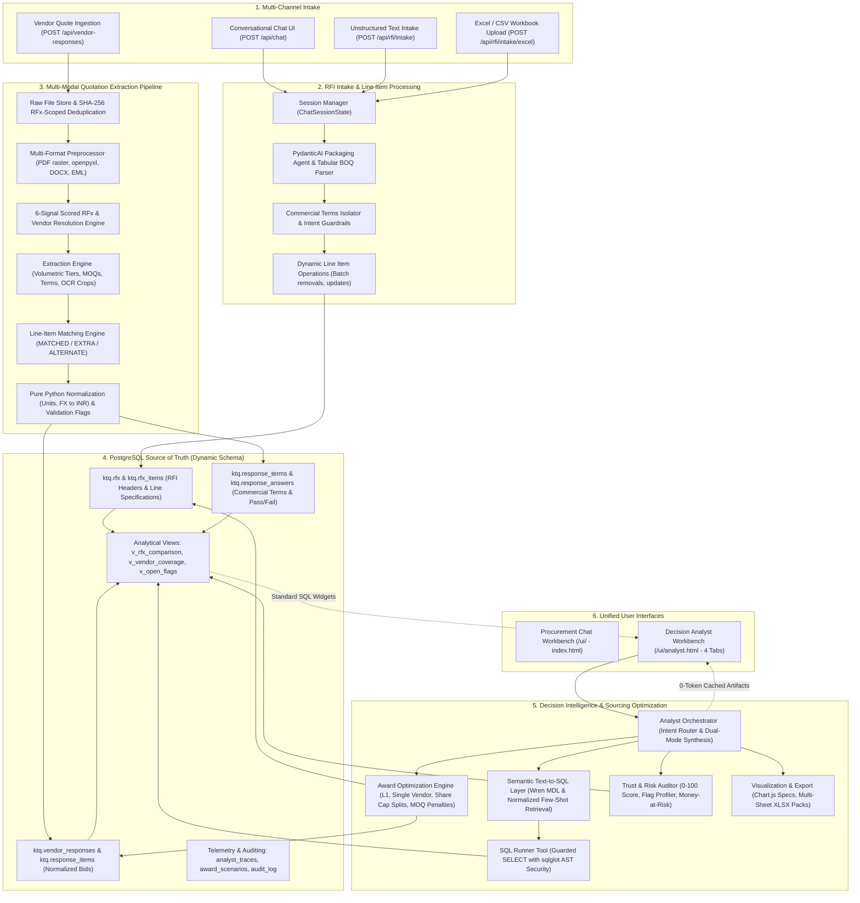

# System Architecture: AI Procurement Analyst & Packaging RFx Platform

## 1. Architectural Vision & Core Principles

The platform is an enterprise-grade AI procurement assistant and decision-support system designed to streamline packaging RFx workflows, automate multi-modal quotation ingestion, and provide mathematically grounded sourcing analytics.

### Foundational Principles
1. **LLM Understands & Narrates; Deterministic Engines Compute**:
   Large Language Models parse unstructured inputs (unstructured packaging requests, natural language questions, messy quotation PDFs/emails) and synthesize executive narratives. All numerical rankings, currency conversions, savings computations, and award allocations are calculated exclusively by deterministic Python algorithms and parameterized PostgreSQL views. Zero numbers are calculated or hallucinated by LLMs.
2. **Comparability First**:
   Procurement comparisons must strictly reflect line-item coverage. Totals are never compared across suppliers without disclosing coverage differences, item-level omissions, and quotation confidence states (`CONFIDENT`, `REVIEW`, `MISSING`).
3. **Defense-in-Depth Security & AST Parsing**:
   Dynamic SQL generation from natural language questions is constrained by an AST parser (`sqlglot`) enforcing strict table/view allowlists on all main queries, CTEs, subqueries, and JOINs. Destructive statements and system catalog accesses are blocked unconditionally.
4. **Cloud & Serverless Host-Agnosticism**:
   Frontend and backend communicate via origin-relative API endpoints (`/api/...`), enabling zero-configuration deployments on local machines, Oracle Cloud Compute, AWS EC2, and Vercel Serverless.

---

## 2. End-to-End System Architecture



---

## 3. Subsystem Architecture & Functional Modules

### 3.1 Conversational RFI Intake & Tabular BOQ Parser (`backend/app/intake/` & `backend/app/agents/`)

- **Stateful Single-RFI Continuity**:
  Conversational sessions track `active_rfi_id`. Incoming requirements augment the active draft rather than generating fragmented RFI records.
- **Enterprise Tabular BOQ Parsing**:
  Supports multi-column TSV, pipe-delimited, and space-aligned tables pasted directly into chat (e.g., `BOQ Item #`, `SKU Code`, `Description`, `Category`, `Target Qty`, `UOM`, `Baseline Price INR`, `Lead Time`). Accurately maps 30+ items per turn with preserved dimensions, UOMs, and baseline rates.
- **Commercial Terms & Boilerplate Auto-Separation**:
  Conversational email greetings/closings, RFP preambles, and delivery conditions (e.g., `Payment Terms: Net 30`, `Delivery Terms: DDP Pune`, `Quote Validity: 90 Days`) are cleanly isolated into RFI header metadata and prevented from creating bogus line items.
- **Dynamic Natural Language Line Operations**:
  - Batch range removals (`remove items 33 to 39`, `delete 1-5`)
  - Comma-separated list removals (`remove 2, 4, 6`)
  - Relative removals (`remove last item`, `delete last 7 items`)
  - Item updates (`update item 1 quantity to 1500`, `change item 2 price to 20 INR`)
  - Contiguous `1..N` re-indexing in PostgreSQL via `ROW_NUMBER()`.

### 3.2 Vendor Quotation Intake, OCR & Extraction (`backend/app/vendor/`)

- **Multi-Modal Document Processing (202 Accepted)**:
  Ingests documents across Excel (`.xlsx`, `.xls`, `.csv`), PDF (rasterized + text), Word (`.docx`), Email (`.eml`), and raw images. Documents are immediately persisted byte-for-byte with SHA-256 idempotency.
- **RFx-Scoped Deduplication**:
  Deduplication is strictly scoped by `rfx_id`. Identical rate sheets uploaded for a newly created RFx are processed as valid distinct submissions for that RFx without collision.
- **6-Signal Scored Resolution Engine**:
  Resolves ambiguous submissions to target RFxs and vendors using weighted signals: (1) Explicit `rfx_id`/`rfx_ref`, (2) Pattern match in text/subject, (3) Email thread headers, (4) Line-item content similarity, (5) Single open RFx heuristic, and (6) Fallback recency. Automatically creates vendor entity records when missing.
- **Volumetric Discount Table & OCR Guidance**:
  Accurately extracts tiered rate break tables common in supplier catalogs and noisy OCR scans (e.g. `100-500 pcs: ₹45, 501-2000 pcs: ₹40, 2001+ pcs: ₹36 | MOQ: 100`). Records lower bounds as line MOQ, captures structured volumetric discount metadata (`{'type': 'volumetric', 'tiers': [...]}`), and segments brackets into distinct item tiers.
- **Deterministic Normalization & Validation**:
  Converts foreign currencies to INR using configured FX rates, normalizes packaging UOMs, detects pricing traps (such as "per 100" or "per 1000" pricing), and flags outliers into `CONFIDENT`, `REVIEW`, or `MISSING` states with explainable remediation instructions. Generates visual 10%-padded PNG crops for PDF line items.

### 3.3 Semantic Decision Analyst & Text-to-SQL Engine (`backend/app/analyst/`)

- **Semantic Layer (Wren MDL)**:
  Defines standardized column semantics (`effective_price_inr`, `state`, `review_status`, `coverage_pct`) over PostgreSQL views.
- **Normalized Few-Shot Intent Matching**:
  Strips stop words and punctuation before matching buyer questions against seed question-to-SQL pairs in `config/wren_examples.yaml`, supporting joins across line items, knockout questions, commercial terms, and open flags.
- **Dual-Mode Narrative Synthesis**:
  - *LLM Active*: Generates executive summaries, winner breakdowns, and state disclosures using `config/prompts/analyst_system_v1.txt`. Evaluates multi-vendor split trade-offs (cost premium delta vs risk reduction vs operational overhead). Leverages LLMs wherever available to generate high-value, nuanced procurement insights while strictly masking internal database primary keys.
  - *Deterministic Fallback*: Analyzes query rows programmatically to construct structured markdown for L1 winners, savings vs budget, quotation coverage, and compliance flags.
- **Human-Readable Identifiers & Primary Key Masking**:
  All client-facing tables, LLM prompt contexts, and narrative breakdowns strictly reference line items by their human-readable **Item #** (e.g. `Item #1`) and **Item Description / Name** (e.g. `3-Ply Corrugated Box`). Technical database keys (`rfx_item_id`, `vendor_id`, `response_id`, `document_id`) are stripped from presentation layers.
- **Ground Truth Traceability Post-Check**:
  Cross-checks all numerical figures in the narrative against executed SQL row values. Ungrounded numbers automatically downgrade confidence.
- **0-Token Artifact Caching, Trace Telemetry & Feedback FK Resilience**:
  Persists generated tables and charts per `rfx_id` in `AnalystRepository`. Repeated identical questions return instant 0-token cached responses while writing execution turn traces (`cached_{trace_id}`) with `path_used="cache"` to `ktq.analyst_traces`. This ensures `ktq.analyst_feedback` foreign key constraints (`analyst_feedback_trace_id_fkey`) are consistently satisfied, keeps session histories contiguous, and provides self-healing stub trace creation and fallback handling if orphaned trace IDs are submitted. Incorporates active validation (`_is_valid_cached_response`) to detect and automatically purge outdated placeholders or legacy degraded representations.
- **In-DOM Table Compliance & Chat History Management**:
  Standardizes chat message tables on native `.comparison-table` elements, avoiding HTML5 in-DOM parser hoisting or element stripping issues associated with component wrappers. Provides dedicated session clearing (`DELETE /api/analyst/sessions/{id}`) and RFx-wide history purging (`DELETE /api/analyst/history/{rfx_id}`) with in-memory cache invalidation.
- **5 Ready-Made Standard SQL Widgets**:
  1. *Overall Basket KPI Banner* (Target Spend, Optimal Spend, Potential Savings, Full vs Partial Quotes).
  2. *Vendor Coverage Breakdown* (100% full quote coverage vs partial quotes, spend per vendor).
  3. *L1 Best Price Summary & Savings* (Lowest quoted prices vs targets).
  4. *Price Spread & Bidder Variance* (Min, Max, Absolute Spread, Spread %).
  5. *Vendor Win Leaderboard* (Items won L1 and spend share).

### 3.4 Deterministic Award Optimization & Scenario Solver (`backend/app/analyst/optimizer.py`)

- **Multi-Criteria Sourcing Strategies**:
  - *Cheapest Per Line (L1)*: Pure lowest-cost allocation across all items.
  - *Single Vendor*: Lowest total spend from a single supplier capable of fulfilling all items.
  - *Multi-Vendor Split*: Constrained allocation enforcing a maximum percentage cap on any single supplier (e.g. 60% cap).
- **Minimum Order Quantity (MOQ) Penalty Constraints**:
  Evaluates supplier line MOQ against required order quantities:
  - `none`: Standard allocation without MOQ enforcement.
  - `shortfall_penalty`: Adds a shortfall penalty cost `(MOQ - Qty) * Unit Price * Penalty Rate` to line spend.
  - `quantity_bump`: Bumps order quantity to vendor MOQ, computing spend on `MOQ * Unit Price` and reporting surplus cost.
  - `exclude_below_moq`: Disqualifies suppliers whose MOQ exceeds required order volume for that line.
- **Knockout Quality Gate**:
  Enforces mandatory pass requirements on RFx technical and quality questionnaire answers.
- **Decision-Support Boundary**:
  Optimization runs purely as simulation scenarios to inform procurement strategy. The system does not execute binding contractual awards or alter RFx lifecycle status.

### 3.5 SQL AST Security Guardrails (`backend/app/analyst/tools/sql_runner.py`)

- **Strict AST Parser (`sqlglot`)**:
  Parses incoming SQL into an abstract syntax tree using the PostgreSQL dialect.
- **Recursive Entity Traversal**:
  Extracts all referenced `exp.Table` nodes across:
  - Main SELECT statements
  - CTE definitions (`WITH` clauses)
  - Subqueries in `FROM`, `WHERE`, `HAVING`, and scalar projections
  - `JOIN` targets
- **CTE Alias Disambiguation**:
  Identifies internal CTE aliases defined in the query and isolates them from physical database tables.
- **Strict Table Allowlist**:
  Rejects any query referencing tables outside `ALLOWED_TABLES_AND_VIEWS` (e.g. `information_schema`, `pg_catalog`, `ktq.rfx_activity`, unauthorized schemas).
- **Execution Safeguards**:
  Enforces `statement_timeout = 5000ms`, single-statement execution (semicolon isolation), read-only keyword verification, and parameter clamping (`LIMIT <= 500`).

---

## 4. Database Schema Architecture

Database entities are organized under a dynamic PostgreSQL schema (`DB_SCHEMA`, default `ktq`):

### Core Tables
| Table | Description |
|---|---|
| `ktq.rfx` | RFx headers, commercial terms, lifecycle status (`DRAFT`, `READY`, `TRIGGERED`, `COMPLETED`). |
| `ktq.rfx_items` | Normalized packaging requirements, quantities, units, target prices, dimensions, specs. |
| `ktq.rfx_questions` | RFx technical/compliance questionnaire, knockout flags. |
| `ktq.vendors` | Supplier master records (name, email, phone, GSTIN, address). |
| `ktq.vendor_responses` | Quotation submission envelope, channel, status, current version flag. |
| `ktq.response_documents` | Raw document bytes, SHA-256 hash, mime type, parsed OCR text, quality score. |
| `ktq.response_items` | Normalized extracted quotation line items, matched RFx item, raw/normalized price, MOQ, flags, crop coordinates. |
| `ktq.response_terms` | Extracted commercial conditions (payment terms, freight, warranty, validity). |
| `ktq.response_answers` | Supplier questionnaire answers and knockout pass/fail evaluation. |
| `ktq.analyst_traces` | Decision analyst Q&A telemetry, SQL executed, tool latencies, response JSON. |
| `ktq.award_scenarios` | Saved allocation scenarios, constraints, and buyer finalization records. |
| `ktq.analyst_audit_log` | Immutable audit trail recording scenario finalization and accepted REVIEW flags. |

### Analytical Views
| View | Purpose |
|---|---|
| `ktq.v_rfx_comparison` | Master comparison matrix: joins RFx items with current supplier quotes, effective INR prices, ranks, and flags. |
| `ktq.v_vendor_coverage` | Vendor quotation coverage % (total items, quoted count, confident quotes, spend totals). |
| `ktq.v_open_flags` | Open validation flags with severity, plain-language explanation, and resolution guidance. |
| `ktq.v_response_items_current` | Current line item extractions with crops, normalized prices, and document metadata. |

---

## 5. Deployment & Runtime Architecture

- **FastAPI ASGI Backend**: High-performance asynchronous API supporting lifespan startup initialization of LLM agents.
- **Vercel Serverless Support**: Configured via `api/index.py` and `vercel.json` for zero-management serverless hosting.
- **Cloud VM Runner (`scripts/run_server.sh`)**: Binds to `0.0.0.0` with configurable `HOST` and `PORT`, forwarding proxy headers for Nginx, Caddy, or Oracle Cloud Load Balancers.
- **Host-Agnostic Single-Page Applications**:
  - `chatbot/index.html`: Unified RFI creation and general procurement assistant.
  - `chatbot/analyst.html`: 4-tab decision analyst workbench (RFI Details, Comparison Grid, Vendor Comparison, AI Chat).
  - Dynamic endpoint resolution uses origin-relative paths (`/api/...`) with automatic migration of legacy `localhost` entries in client `localStorage`.

---

## 6. Verification & Test Suite

The test harness provides 100% coverage across business logic, offline parsing, AST security, and database-dependent components:

- **Offline/Unit Testing**: Automatically executes in isolation without external database or LLM requirements.
- **PostgreSQL Tests**: Managed via dynamic `requires_db` pytest marker in `tests/conftest.py`.

Run full test suite:
```bash
PYTHONPATH=. .venv/bin/pytest tests/ backend/tests/ -v
```
Test execution traces are stored in `artifacts/logs/`.
